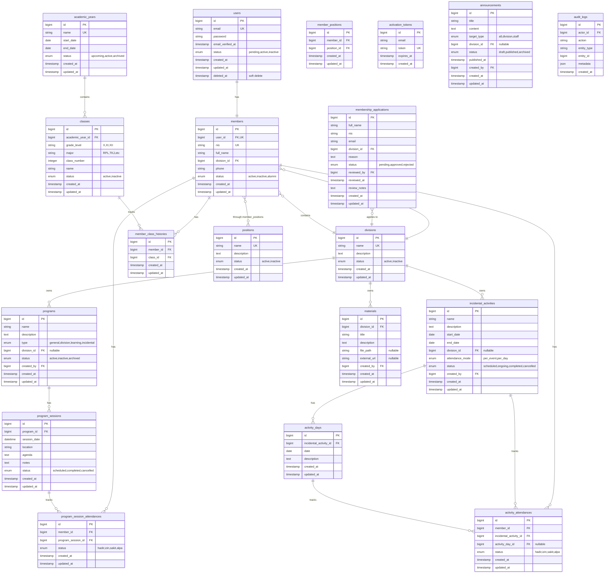

# Entity Relationship Diagram — IPMI

## 1. Tujuan

Dokumen ini menjelaskan struktur database final untuk MVP aplikasi IPMI berdasarkan keputusan yang telah disepakati.

## 2. Diagram Mermaid

## 3. Daftar Tabel dan Relasi

### 3.1 Autentikasi dan Profil

#### users
- **Primary Key:** id
- **Unique:** email
- **Soft Delete:** deleted_at
- **Relasi:** 1:1 dengan members via members.user_id

#### members
- **Primary Key:** id
- **Foreign Keys:**
  - user_id → users.id (unique)
  - division_id → divisions.id
- **Unique:** nis, user_id
- **Relasi:**
  - 1:1 dengan users
  - N:1 dengan divisions
  - 1:N dengan member_class_histories
  - N:M dengan positions via member_positions

### 3.2 Organisasi

#### divisions
- **Primary Key:** id
- **Unique:** name
- **Data Initial:** Kaligrafi, MTQ, Dakwah, Hadroh

#### positions
- **Primary Key:** id
- **Unique:** name
- **Contoh:** Ketua Umum, Sekretaris, Bendahara, Ketua Divisi, Anggota Divisi

#### member_positions
- **Primary Key:** id
- **Foreign Keys:**
  - member_id → members.id
  - position_id → positions.id
- **Unique Constraint:** (member_id, position_id)

### 3.3 Tahun Ajaran dan Kelas

#### academic_years
- **Primary Key:** id
- **Unique:** name
- **Status Values:** upcoming, active, archived
- **Constraint:** Maksimal satu tahun ajaran berstatus 'active' (validasi aplikasi)

#### classes
- **Primary Key:** id
- **Foreign Keys:**
  - academic_year_id → academic_years.id
- **Unique Constraint:** (academic_year_id, grade_level, major, class_number)
- **Contoh:** X RPL 1, XI TKJ 2, XII RPL 1

#### member_class_histories
- **Primary Key:** id
- **Foreign Keys:**
  - member_id → members.id
  - class_id → classes.id
- **Unique Constraint:** (member_id, class_id)
- **Catatan:** Satu anggota hanya boleh satu kelas per tahun ajaran (validasi via class_id yang sudah linked ke academic_year)

### 3.4 Pendaftaran

#### membership_applications
- **Primary Key:** id
- **Foreign Keys:**
  - division_id → divisions.id
  - reviewed_by → users.id (nullable)
- **Status Values:** pending, approved, rejected
- **Validasi:** Maksimal 3 permohonan per NIS (WHERE status IN ('pending', 'approved'))

#### activation_tokens
- **Primary Key:** id
- **Unique:** token
- **Catatan:** Token untuk aktivasi akun setelah permohonan disetujui

### 3.5 Program dan Kegiatan

#### programs
- **Primary Key:** id
- **Foreign Keys:**
  - division_id → divisions.id (nullable, NULL untuk program umum)
  - created_by → users.id
- **Type Values:** general, division, learning, incidental

#### program_sessions
- **Primary Key:** id
- **Foreign Keys:**
  - program_id → programs.id

#### incidental_activities
- **Primary Key:** id
- **Foreign Keys:**
  - division_id → divisions.id (nullable)
  - created_by → users.id
- **Attendance Mode:** per_event (satu presensi untuk seluruh kegiatan), per_day (presensi per hari)

#### activity_days
- **Primary Key:** id
- **Foreign Keys:**
  - incidental_activity_id → incidental_activities.id
- **Catatan:** Hanya untuk kegiatan dengan attendance_mode = 'per_day'

### 3.6 Presensi

#### program_session_attendances
- **Primary Key:** id
- **Foreign Keys:**
  - member_id → members.id
  - program_session_id → program_sessions.id
- **Unique Constraint:** (member_id, program_session_id)
- **Status Values:** hadir, izin, sakit, alpa

#### activity_attendances
- **Primary Key:** id
- **Foreign Keys:**
  - member_id → members.id
  - incidental_activity_id → incidental_activities.id
  - activity_day_id → activity_days.id (nullable)
- **Unique Constraint:** (member_id, incidental_activity_id, activity_day_id)
- **Status Values:** hadir, izin, sakit, alpa
- **Logika:**
  - Jika activity_day_id NULL: presensi untuk seluruh kegiatan
  - Jika activity_day_id NOT NULL: presensi untuk hari tertentu

### 3.7 Materi

#### materials
- **Primary Key:** id
- **Foreign Keys:**
  - division_id → divisions.id
  - created_by → users.id
- **Catatan:** Salah satu dari file_path atau external_url harus diisi

### 3.8 Pengumuman

#### announcements
- **Primary Key:** id
- **Foreign Keys:**
  - division_id → divisions.id (nullable, NULL untuk pengumuman ke semua)
  - created_by → users.id
- **Target Type:** all (semua anggota), division (divisi tertentu), staff (pengurus)

### 3.9 Audit

#### audit_logs
- **Primary Key:** id
- **Foreign Keys:**
  - actor_id → users.id
- **Catatan:** 
  - Tidak ada update/delete, hanya insert
  - metadata berisi detail perubahan dalam format JSON
  - Tidak menyimpan password, token, atau rahasia

## 4. Constraints dan Indexes

### Primary Keys
Semua tabel menggunakan auto-increment bigint sebagai primary key.

### Foreign Keys
Semua foreign key menggunakan RESTRICT atau CASCADE sesuai kebutuhan:
- **CASCADE on delete:** Tidak digunakan untuk data inti, gunakan soft delete
- **RESTRICT on delete:** Default untuk mencegah penghapusan data yang masih berelasi
- **SET NULL on delete:** Untuk relasi opsional yang tidak boleh restrict (contoh: created_by)

### Unique Constraints

1. **users:** email
2. **members:** nis, user_id
3. **divisions:** name
4. **academic_years:** name
5. **classes:** (academic_year_id, grade_level, major, class_number)
6. **member_class_histories:** (member_id, class_id)
7. **positions:** name
8. **member_positions:** (member_id, position_id)
9. **activation_tokens:** token
10. **program_session_attendances:** (member_id, program_session_id)
11. **activity_attendances:** (member_id, incidental_activity_id, activity_day_id)

### Indexes (Selain yang Otomatis dari PK/FK/Unique)

1. **users:** status
2. **members:** division_id, status
3. **academic_years:** status (untuk query tahun ajaran active)
4. **classes:** academic_year_id, status
5. **member_class_histories:** member_id, class_id (composite)
6. **membership_applications:** nis, status, reviewed_by
7. **programs:** division_id, type, status
8. **program_sessions:** program_id, session_date
9. **incidental_activities:** start_date, end_date, status
10. **audit_logs:** actor_id, entity_type, entity_id, created_at

## 5. Aturan Integritas (Level Aplikasi)

Aturan berikut tidak dapat dijamin hanya dengan constraint database dan harus divalidasi di aplikasi:

### 5.1 Tahun Ajaran
- Hanya satu tahun ajaran boleh berstatus 'active'
- Validasi sebelum insert/update academic_years
- Gunakan database transaction untuk mencegah race condition

### 5.2 Kelas Anggota
- Setiap anggota aktif WAJIB memiliki kelas pada tahun ajaran active
- Satu anggota hanya boleh satu kelas per tahun ajaran
- Tidak boleh pindah rombel di tengah tahun ajaran (kecuali koreksi)
- Validasi saat create/update member_class_histories

### 5.3 Presensi
- Validasi attendance_mode sebelum insert activity_attendances
- Jika mode 'per_event': activity_day_id harus NULL
- Jika mode 'per_day': activity_day_id harus NOT NULL
- Validasi activity_day_id benar-benar milik incidental_activity_id tersebut

### 5.4 Pendaftaran
- Maksimal 3 permohonan per NIS dengan status 'pending' atau 'approved'
- Count: `WHERE nis = ? AND status IN ('pending', 'approved')`

### 5.5 Authorization
- Ketua Divisi hanya akses data divisinya
- Ketua Umum dan Sekretaris akses semua divisi
- Validasi pada setiap query dan mutation

## 6. Data yang Dipertahankan Saat Penonaktifan

### Akun Dinonaktifkan (users.status = 'inactive' atau soft delete)
- ✅ Data member tetap ada
- ✅ Riwayat kelas tetap ada
- ✅ Riwayat presensi tetap ada
- ✅ Audit log tetap ada
- ✅ Jabatan organisasi bisa dihapus (member_positions)
- ❌ Tidak bisa login
- ❌ Tidak muncul di direktori anggota aktif

### Kelas Diarsipkan (classes.status = 'inactive')
- ✅ Riwayat member_class_histories tetap ada
- ❌ Tidak bisa dipilih untuk penempatan baru

### Program Diarsipkan (programs.status = 'archived')
- ✅ Riwayat sesi tetap ada
- ✅ Riwayat presensi tetap ada
- ❌ Tidak bisa create sesi baru

## 7. Validasi Keputusan Terhadap Dokumentasi

### Relasi Akun dan Anggota (D-027) ✅
- users 1:1 members via members.user_id
- Penonaktifan menggunakan soft delete atau status
- Foreign key dengan unique constraint

### Status Tahun Ajaran (D-028) ✅
- Tiga status: upcoming, active, archived
- Single active year (validasi aplikasi)
- Struktur tabel lengkap dengan start_date dan end_date

### Kelas Wajib (D-026) ✅
- Tidak ada constraint database yang enforce ini
- Validasi di aplikasi saat status anggota = 'active'
- member_class_histories menyimpan riwayat

### Perpindahan Rombel (D-025) ✅
- Tidak ada fitur perpindahan otomatis
- Koreksi kelas = update member_class_histories + audit log
- Validasi tahun ajaran yang sama di aplikasi

### Struktur Presensi (D-029) ✅
- Dua tabel terpisah: program_session_attendances dan activity_attendances
- Foreign key eksplisit (tidak polymorphic)
- Unique constraints mencegah duplikasi
- activity_day_id nullable untuk mode per_event

### Divisi (D-003) ✅
- Empat divisi: Kaligrafi, MTQ, Dakwah, Hadroh
- members.division_id NOT NULL
- Tidak ada fitur perpindahan divisi di MVP

### Authorization Matrix ✅
- created_by menyimpan pembuat
- division_id untuk filtering data
- Validasi hak akses di aplikasi, bukan database

## 8. Catatan Implementasi

1. **Migrasi Database:**
   - Buat migrasi dalam urutan dependency (users → divisions → members, dst)
   - Gunakan migration rollback yang aman
   - Seed data awal: 4 divisi

2. **Soft Delete:**
   - Gunakan Laravel SoftDeletes trait untuk users
   - Alternatif: kolom status jika soft delete tidak diperlukan

3. **Enum di MySQL:**
   - Gunakan ENUM untuk kolom dengan pilihan terbatas dan stabil
   - Alternatif: string dengan validasi aplikasi jika lebih fleksibel

4. **Timestamps:**
   - Semua tabel menggunakan created_at dan updated_at (Laravel default)
   - audit_logs hanya created_at

5. **JSON Metadata:**
   - audit_logs.metadata menggunakan JSON column
   - Simpan data relevan: old_value, new_value, reason, ip_address

6. **Partial Index:**
   - MySQL 8.0+ mendukung functional index
   - Untuk single active year: buat unique index pada (status) WHERE status = 'active'
   - Jika tidak support: validasi di aplikasi dengan row locking

## 9. Keputusan yang Masih Terbuka

Keputusan berikut tidak menghambat pembuatan migrasi:

1. **D-019:** Aturan permohonan yang dibatalkan
   - Struktur tabel sudah cukup
   - Aturan counting akan di aplikasi

2. **D-020:** Masa berlaku token aktivasi
   - Tabel activation_tokens sudah ada expires_at
   - Nilai default bisa ditentukan saat implementasi

3. **D-021:** Perubahan kehadiran setelah sesi selesai
   - Struktur tabel sudah cukup
   - Validasi batas waktu di aplikasi

4. **D-022:** Hak akses Bendahara
   - Tidak ada tabel khusus
   - Ditangani via authorization matrix

5. **D-023:** Siapa boleh baca audit log
   - Struktur tabel sudah cukup
   - Policy di aplikasi

## 10. Status Desain

**Status:** FINAL - Siap Implementasi

**Tanggal:** 2026-10-23

**Approved:** Keputusan D-027, D-028, D-029 telah disepakati

**Next Step:** Implementasi migrasi Laravel berdasarkan ERD ini

---

Desain database ini mencakup seluruh entitas MVP yang diperlukan dan konsisten dengan keputusan yang telah disepakati dalam `docs/decisions.md`.
